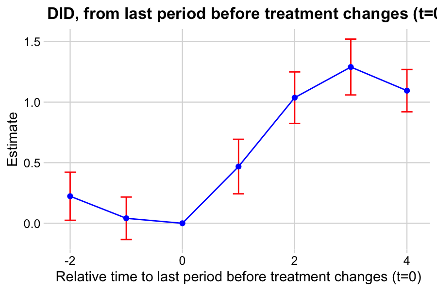

# Quick start

Five minutes is enough to estimate a DiD model with didgpu. This chapter uses the package's built-in simulator so you can reproduce every example without assembling real-world data first.

## Generate a panel

didgpu includes `didgpu_simulate_panel()`, which creates a tidy long panel with a known treatment effect built into the data-generating process. We use it throughout this chapter so the values you see on screen correspond directly to the examples in the text.

```r
library(didgpu)

panel <- didgpu_simulate_panel(
  n_units          = 60,
  n_periods        = 12,
  frac_treated     = 0.6,
  min_treat_period = 4,
  max_treat_period = 9,
  tau_profile      = c(0.5, 1.0, 1.2, 1.0, 0.8),
  sigma            = 0.4,
  seed             = 17
)

head(panel)
#>   unit period D          Y
#> 1    1      1 0 -0.3859350
#> 2    1      2 0  0.9423873
#> 3    1      3 0 -0.1117813
#> 4    1      4 0 -0.6311500
#> 5    1      5 0 -0.5164363
#> 6    1      6 0 -0.5039224

nrow(panel)
#> [1] 720
```

`panel` is a long-form data frame with 720 rows and four columns:

- `unit` identifies the unit (1 through 60).
- `period` indexes time (1 through 12).
- `D` is the treatment indicator: 0 before treatment and 1 after treatment.
- `Y` is the observed outcome.

What this setup is doing:

- **60 units and 12 periods** produce 720 total observations. This is small enough to run quickly, yet large enough to give the estimator meaningful variation.
- **60% treated** means that 36 units eventually receive treatment, while 24 units remain never-treated. Those never-treated units provide the clean comparison group.
- **`min_treat_period = 4` and `max_treat_period = 9`** imply that each treated unit adopts treatment at a random period between 4 and 9. Different units switch at different times, which is the staggered-adoption setting that the modern DiD estimators in didgpu are designed to handle.
- **`tau_profile = c(0.5, 1.0, 1.2, 1.0, 0.8)`** is the true event-study effect. At event time 0, the effect on `Y` is 0.5; one period later it is 1.0; two periods later it reaches 1.2; and then it gradually decays. This is the target the estimator is meant to recover.
- **`sigma = 0.4`** adds Gaussian noise so the data look realistic rather than perfectly synthetic.
- **`seed = 17`** fixes the random draws so anyone who runs the code gets the same panel.

The first six rows show unit 1 in its first six periods, all with `D = 0`. That is because unit 1 happens to be one of the never-treated units in this draw. Units that eventually receive treatment begin with `D = 0` and switch to `D = 1` at their assigned adoption period.

## Fit the dynamic DiD estimator

The primary estimator in didgpu is `didgpu()`, which implements the
heterogeneity-robust dynamic DiD estimator of de Chaisemartin and
D'Haultfoeuille (2024). For staggered-adoption designs, it estimates treatment
effects at each event-time horizon after treatment while using comparisons that
avoid already-treated units, the source of the bias that affects standard
two-way fixed-effects regressions.

```r
fit <- didgpu(
  panel,
  outcome   = "Y",
  group     = "unit",
  time      = "period",
  treatment = "D",
  effects   = 4,
  placebo   = 2
)
```

The key arguments are straightforward:

- `outcome`, `group`, `time`, and `treatment` identify the four columns the estimator needs. Passing them as strings keeps the function signature aligned with `DIDmultiplegtDYN::did_multiplegt_dyn()`.
- `effects = 4` requests four post-treatment event-time effects: the effect in the treatment period and in each of the next three periods.
- `placebo = 2` requests two pre-treatment placebo estimates. These serve as falsification tests for the parallel-trends assumption: if there is no treatment effect before treatment, the placebo estimates should be close to zero.

There is no `bootstrap_reps` argument in this call. Since version 0.1.2, the standard errors, confidence intervals, and joint-nullity tests are computed analytically from the estimator's asymptotic influence functions, so a bootstrap is no longer required for default inference. Setting `bootstrap_reps` above zero still works, but it does not change the reported `SE` column. See the "When to add a bootstrap" section below for the practical guidance.

## Read the output

Printing the fitted object shows four blocks that match the output from `DIDmultiplegtDYN` line for line.

```r
fit
#>
#> ----------------------------------------------------------------------
#>        Estimation of treatment effects: Event-study effects
#> ----------------------------------------------------------------------
#>              Estimate SE      LB CI   UB CI   N   Switchers
#> Effect_1     0.46833  0.11489 0.24315 0.69350 278 36
#> Effect_2     1.03675  0.10837 0.82435 1.24914 247 36
#> Effect_3     1.28974  0.11761 1.05923 1.52024 221 36
#> Effect_4     1.09481  0.08919 0.92001 1.26962 201 36
#>
#> Test of joint nullity of the effects : p-value = 0.0000
#> ----------------------------------------------------------------------
#>     Average cumulative (total) effect per treatment unit
#> ----------------------------------------------------------------------
#>  Estimate        SE     LB CI     UB CI         N Switchers
#>   0.97241   0.08404   0.80769   1.13712       458       144
#> Average number of time periods over which a treatment effect is accumulated: 2.5000
#>
#> ----------------------------------------------------------------------
#>      Testing the parallel trends and no anticipation assumptions
#> ----------------------------------------------------------------------
#>              Estimate SE      LB CI    UB CI   N   Switchers
#> Placebo_1    0.04120  0.08947 -0.13416 0.21656 278 36
#> Placebo_2    0.22337  0.10129 0.02485  0.42189 247 36
#>
#> Test of joint nullity of the placebos : p-value = 0.0640
```

**The Effects block.** Each row is a cumulative DiD estimate at one event-time horizon. `Effect_1` is the effect in the treatment period, `Effect_2` is the effect one period later, and so on. The `N` column gives the number of observations used to compute each estimate, while `Switchers` is the number of treated units contributing to that horizon.

Compare the estimates to the true profile built into the panel via `tau_profile = c(0.5, 1.0, 1.2, 1.0, 0.8)`:

| Horizon  | True effect | Estimate | CI             |
|----------|-------------|----------|----------------|
| Effect_1 | 0.50        | 0.47     | (0.24, 0.69)   |
| Effect_2 | 1.00        | 1.04     | (0.82, 1.25)   |
| Effect_3 | 1.20        | 1.29     | (1.06, 1.52)   |
| Effect_4 | 1.00        | 1.09     | (0.92, 1.27)   |

Every true effect lies inside its 95% confidence interval. The estimator recovers the dynamic profile within sampling error, which is exactly what we want to see on simulated data where the truth is known.

The **joint-nullity test** at the bottom of the Effects block tests `H0: all four effects are zero`. The p-value is effectively zero, so we reject the null that treatment had no effect at any horizon.

**The ATE block.** The row labelled "Average cumulative (total) effect per treatment unit" reports a single summary number: the switcher-weighted average effect per unit of treatment. The final line of the block, "Average number of time periods over which a treatment effect is accumulated: 2.5000", gives the mean horizon length across switchers.

A note on interpretation: the ATE in didgpu is not simply the mean of the Effects column. It is a weighted average per unit of treatment, and the two coincide only when treatment is binary and absorbing, as it is here. In settings with multivalued or continuous treatment, the ATE denominator reflects the average treatment change among switchers, so the two quantities can diverge. The function help (`?didgpu`) gives the exact formula.

**The Placebos block.** Pre-treatment placebo estimates are a falsification test. If parallel trends holds, the placebo effects should be close to zero. `Placebo_1` here is 0.04, which is comfortably near zero, while `Placebo_2` is 0.22 and its confidence interval does not include zero. The joint-nullity p-value is 0.064, which is borderline.

This is an important feature even on simulated data, where the data-generating process satisfies parallel trends by construction. With finite samples, random noise can still push a placebo away from zero, and that is exactly what the test is designed to reveal. On real data, a significant placebo should prompt a careful reconsideration of whether the parallel-trends assumption is credible in the application.

## Access the fitted object

The fit is a `didgpu_result` object. Its structure:

```r
class(fit)
#> [1] "didgpu_result" "list"

names(fit)
#>  [1] "coef"                 "results"              "args"
#>  [4] "cells_used"           "N_switchers_effect_1" "N_switchers_effect_2"
#>  [7] "N_switchers_effect_3" "N_switchers_effect_4" "checkpoint_dir"
#> [10] "plot"
```

The components you will reach for most often:

- `fit$results` holds the three matrices (`Effects`, `ATE`,
  `Placebos`) that produce the printed output.
- `fit$coef` holds the point estimates, their analytic covariance
  matrix, and the influence functions used to build it.
- `fit$plot` is a ggplot2 object of the event-study graph (shown
  below).
- `fit$args` records the arguments the call was made with. Useful
  for reproducibility and when you resume a long-running fit from a
  checkpoint.

The accessor functions covered later in this chapter are the cleaner way to pull estimates and intervals for downstream use.

## Plot the event-study estimates

Fitting the model automatically draws an event-study plot in the RStudio
Plots pane. The same ggplot2 object is stored in `fit$plot`, which means you
can redraw it, customize it, or save it to a file without re-estimating the
model.

```r
plot(fit)
```



The horizontal axis indexes time relative to the last untreated period before
treatment begins (`t = 0`). Negative horizons are the pre-treatment placebos
(`Placebo_2` at `-2`, `Placebo_1` at `-1`), the point at `0` is the reference
period and is fixed at zero by construction, and the positive horizons are the
post-treatment effects (`Effect_1` at `1` through `Effect_4` at `4`). The error
bars show the 95% confidence intervals reported in the fit output.

Reading the plot:

- The two placebo points are close to zero, but not exactly on it, which is consistent with the borderline joint-nullity p-value of 0.064 reported above.
- The estimated effects rise from `Effect_1` to a peak at `Effect_3`, then flatten. This matches the true profile `tau_profile = c(0.5, 1.0, 1.2, 1.0, 0.8)` used to generate the data.
- The confidence intervals are wide enough to reflect sampling noise, but narrow enough that the post-treatment effects are clearly separated from zero.

To save the plot to a file for a paper or slide deck:

```r
ggplot2::ggsave("eventstudy.png", fit$plot, width = 6, height = 4, dpi = 300)
```

To modify the plot, treat `fit$plot` as any other ggplot2 object and compose it with the usual `+` operator:

```r
library(ggplot2)
fit$plot +
  labs(
    title = "Dynamic treatment effects: event study",
    y     = "Estimated effect on Y"
  ) +
  theme_minimal()
```

To suppress the automatic draw entirely, pass `graph_off = TRUE` to the
`didgpu()` call. The ggplot2 object remains available at `fit$plot` and can be
rendered later when needed.

## Access the estimates programmatically

For downstream work, the standard accessor functions all work on a
`didgpu_result` object. These are the main tools for extracting point
estimates, uncertainty measures, and tidy summaries without manually
re-parsing the printed output.

**Point estimates.**

```r
coef(fit)
#>   Effect_1   Effect_2   Effect_3   Effect_4  Placebo_1  Placebo_2        ATE
#> 0.46832720 1.03674519 1.28973624 1.09481177 0.04120344 0.22337031 0.97240510
```

`coef()` returns the full named vector: the four dynamic effects, the two
placebo estimates, and the ATE. You can subset by name when you want a single
entry:

```r
coef(fit)["Effect_2"]
```

**Analytic covariance matrix.**

```r
vcov(fit)
```

`vcov()` returns the covariance matrix for the four dynamic effects and the two
placebo estimates. The ATE is not a linear combination of those coefficients, so
it does not appear in this matrix. If you need the variance for the ATE, use the
`SE` column in the ATE block from `fit$results$ATE`.

**Confidence intervals.**

```r
confint(fit)
#>                95% LB    95% UB
#> Effect_1   0.24315340 0.6935010
#> Effect_2   0.82434795 1.2491424
#> Effect_3   1.05923303 1.5202395
#> Effect_4   0.92000820 1.2696153
#> Placebo_1 -0.13415536 0.2165622
#> Placebo_2  0.02485349 0.4218871
#> ATE        0.80768812 1.1371221
```

These confidence intervals are the same ones reported by the original fit, at
whatever level was requested in the call to `didgpu()` (`ci_level = 95` by
default). The call `confint(fit, level = 0.90)` does not recompute the interval
at a new level; it returns the stored 95% intervals and emits a warning telling
you to re-fit the model with `ci_level = 0.9` if you want a different level.
The intervals are computed from the analytic covariance matrix at fit time, not
on demand.

**Tidy data frames.**

For a one-row-per-parameter data frame that is convenient for plotting or joining
with other results, use `didgpu_tidy()`:

```r
didgpu_tidy(fit)
#>        term   estimate  std.error  statistic      p.value    conf.low   conf.high    kind
#> 1  Effect_1 0.46832720 0.11488670  4.0764265 4.573311e-05  0.24315340 0.6935010  effect
#> 2  Effect_2 1.03674519 0.10836793  9.5669005 1.101587e-21  0.82434795 1.2491424  effect
#> 3  Effect_3 1.28973624 0.11760584 10.9666001 5.531336e-28  1.05923303 1.5202395  effect
#> 4  Effect_4 1.09481177 0.08918713 12.2754452 1.227150e-34  0.92000820 1.2696153  effect
#> 5       ATE 0.97240510 0.08404082 11.5706286 5.805577e-31  0.80768812 1.1371221     ate
#> 6 Placebo_1 0.04120344 0.08947042  0.4605258 6.451388e-01 -0.13415536 0.2165622 placebo
#> 7 Placebo_2 0.22337031 0.10128595  2.2053435 2.743000e-02  0.02485349 0.4218871 placebo
```

The `kind` column distinguishes effects, the ATE, and placebo estimates, making
it easy to filter or reshape the results:

```r
library(dplyr)
didgpu_tidy(fit) |>
  filter(kind == "effect") |>
  select(term, estimate, conf.low, conf.high)
```

For a one-row summary of the fit, use `didgpu_glance()`:

```r
didgpu_glance(fit)
#>   n_effects n_placebos n_switchers_e1 n_obs_e1 p_jointeffects p_jointplacebo n_boot backend seed
#> 1         4          2             36      278              0     0.06401752      0    auto    1
```

**A note on `broom`.** didgpu does not currently register S3 methods with the
`broom` package namespace, so `broom::tidy(fit)` and `broom::glance(fit)` will
error with "No `tidy()` method recognized for this list." The native
`didgpu_tidy()` and `didgpu_glance()` functions above return the same tidy-shaped
objects without introducing a `broom` dependency.

## When to add a bootstrap

For almost every didgpu workflow, the answer is simple: you usually do not need
one. Since version 0.1.2, the standard errors, confidence intervals, and
joint-nullity tests are computed analytically from the estimator's asymptotic
influence functions. The output shown earlier in this chapter already contains the
valid default inference. There is no hidden step being skipped by leaving
`bootstrap_reps` at its default value of zero.

The package makes this explicit when a non-zero `bootstrap_reps` value is passed:

```text
did_multiplegt_dyn computes by default analytical standard errors -
in most cases, there is no need to use the bootstrap option.
Bootstrapping is a much slower alternative and we recommend it only
in combination with the continuous option.
```

In practice, running a bootstrap on the same panel confirms that it does not
change the reported standard errors:

```r
fit_boot <- didgpu(
  panel,
  outcome      = "Y",
  group        = "unit",
  time         = "period",
  treatment    = "D",
  effects      = 4,
  placebo      = 2,
  bootstrap_reps = 200,
  seed         = 42
)
```

```r
cbind(
  analytic  = fit$results$Effects[, "SE"],
  bootstrap = fit_boot$results$Effects[, "SE"]
)
#>               analytic  bootstrap
#> Effect_1     0.11488670 0.11488670
#> Effect_2     0.10836793 0.10836793
#> Effect_3     0.11760584 0.11760584
#> Effect_4     0.08918713 0.08918713
```

The two columns are identical to every printed digit, and the point estimates are
unchanged. The bootstrap still performs its resampling loop and populates a
bootstrap covariance object inside `fit_boot`, but the `SE` column itself remains
anchored to the analytic path.

When should you actually use it? One case is called out explicitly by the
package: when `continuous` is set in the call to `didgpu()`. In that setting, the
analytic standard errors can be somewhat liberal, and the bootstrap provides a
more conservative alternative. The dynamic DiD chapter covers that path in more
detail.

For any other workflow (binary treatment, multivalued treatment, staggered
adoption, controls, or weights), leave `bootstrap_reps` at its default. You save
minutes to hours of compute time without giving up anything in the reported
inference.

## Save and reload a fit

A `didgpu_result` is just an R list with an S3 class attached, so
`saveRDS()` and `readRDS()` work exactly as they do for any other R object.

```r
saveRDS(fit, "quickstart_fit.rds")

fit_reloaded <- readRDS("quickstart_fit.rds")
coef(fit_reloaded)
#>   Effect_1   Effect_2   Effect_3   Effect_4  Placebo_1  Placebo_2        ATE
#> 0.46832720 1.03674519 1.28973624 1.09481177 0.04120344 0.22337031 0.97240510
```

The reloaded fit prints the same output, preserves the same point estimates,
standard errors, covariance matrix, and confidence intervals, and remains fully
compatible with the accessor functions shown above.

A note on strict object identity: if you run `identical(fit, fit_reloaded)`, the
result is `FALSE`, not `TRUE`. The numerical components round-trip exactly:
`identical(fit$results, fit_reloaded$results)` and
`identical(fit$coef, fit_reloaded$coef)` both return `TRUE`. The difference
comes from the ggplot2 object stored in `fit$plot`: it carries environment
pointers that change when the object is serialized, and `identical()` compares
those too. Nothing in the underlying estimates or inference is affected. If you
need a strict equality check in a test suite, compare the components you care
about directly rather than the top-level object.

For long-running fits with bootstrap replicates or larger panels, the checkpoint
system described in the "Reproducibility and checkpointing" chapter is usually a
better choice than `saveRDS()`: it writes one cell per bootstrap replicate as the
fit runs, so you can resume after a crash without redoing the full computation.

## Where to go next

You have now installed didgpu, generated a panel, fit the flagship dynamic DiD
estimator, read the output, plotted the event-study graph, extracted estimates
programmatically, understood when (and when not) to use a bootstrap, and saved a
fit for later. This brings the quickstart to a close.

From here, three directions are especially useful depending on your application:

- **Choose the right estimator for your design.** didgpu offers several
  estimator families, and the best choice depends on how treatment is defined and
  which identifying assumptions you are willing to make. The [Choosing an
  Estimator](02b-choosing-estimator.qmd) chapter walks through the decision.
- **Go deeper on the dynamic DiD estimator.** This quickstart used `didgpu()` with
  its default settings. The [Dynamic DiD](03-dynamic-did.qmd) chapter documents
  every argument, covers covariates and weights, describes the diagnostic options
  (`predict_het`, `effects_equal`), and explains the continuous-treatment path.
- **Apply didgpu to other causal designs.** The [Callaway-Sant'Anna](04-callaway-santanna.qmd)
  chapter covers staggered adoption with a clearly defined control group; the
  [FEct, IFEct, and MC](05-fect-ifect-mc.qmd) chapter covers the
  counterfactual-imputation family; the [Static DID_M](06-static-did.qmd) chapter
  covers non-absorbing binary treatment; and the [Continuous treatment](07-continuous-treatment.qmd)
  chapter covers settings without a clean never-treated group.

For longer-running work, the [Reproducibility and checkpointing](10-reproducibility-checkpointing.qmd)
chapter explains how to resume fits after crashes, and the [GPU and performance](08-gpu-and-performance.qmd)
chapter covers when the CUDA backend is worth setting up and which speedups to
expect.